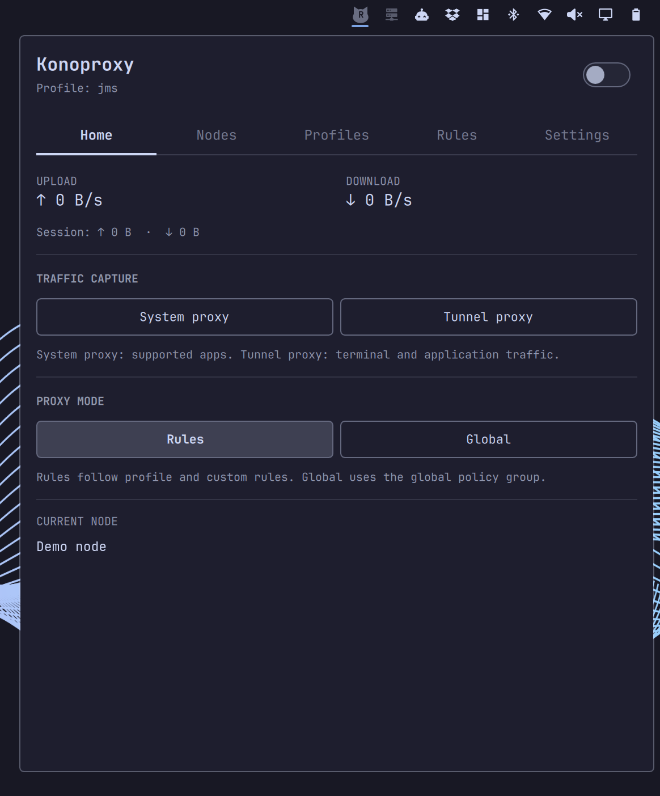

<div align="center">

# Konochi

### Your desktop. Your taste.

A personal collection of native Omarchy plugins by [Alec Xu](https://github.com/xvvhang).

[Explore the plugins](#plugins) · [Screenshots](#screenshots) · [Installation](#installation) · [Feedback](#feedback)

</div>

---

Inspired by *konomi* — preference or taste — Konochi brings small, thoughtful
improvements to the desktop you use every day. Keep your workspaces recognizable,
your windows within reach, your music visible, your dev ports and proxy routing
under control, and your next break on time.

## Plugins

| Plugin | What it does | Plugin ID |
| --- | --- | --- |
| [**Konoports**](https://github.com/xvvhang/omarchy-konoports-plugin) | Local dev servers, listening ports and process commands, with browser links and confirmed process termination. | `konochi.konoports` |
| [**Konoproxy**](https://github.com/xvvhang/omarchy-konoproxy-plugin) | Native Mihomo proxy controls, subscriptions, profiles, rules, node selection and latency checks, with explicitly authorized core setup. | `konochi.konoproxy` |
| [**Konousage**](https://github.com/xvvhang/omarchy-konousage-plugin) | Account-separated ChatGPT coding quotas and reset times for OpenCode and Codex. | `konochi.konousage` |
| [**Konobreak**](https://github.com/xvvhang/omarchy-konobreak-plugin) | Work and break intervals with a bar countdown, notifications, pause/resume, and snoozing. | `konochi.konobreak` |
| [**Konobeat**](https://github.com/xvvhang/omarchy-konobeat-plugin) | Now-playing controls, scrolling track information, and eight real-audio visualization styles. | `konochi.konobeat` |
| [**Konoview**](https://github.com/xvvhang/omarchy-konoview-plugin) | A fullscreen window overview with live previews, keyboard hints, search, and optional double-Super activation. | `konochi.konoview` |
| [**Konostat**](https://github.com/xvvhang/omarchy-konostat-plugin) | CPU, GPU, memory, storage, network, fan, and temperature monitoring with configurable bar metrics. | `konochi.konostat` |
| [**Konospaces**](https://github.com/xvvhang/omarchy-konospaces-plugin) | Workspace labels with per-window application icons, special-workspace support, and live updates. | `konochi.konospaces` |

Each plugin has its own repository, documentation, license, and issue tracker.
This repository is the series showcase, not an installable Omarchy plugin.

## Screenshots

Screenshots are maintained in this showcase's `assets/` directory or as
`preview.png` in each plugin repository. Select an image to view it at full resolution.

| Konoports | Konoproxy |
| --- | --- |
| [](assets/konoports.png) | [](assets/konoproxy.png) |

| Konousage | Konobreak |
| --- | --- |
| [](https://github.com/xvvhang/omarchy-konousage-plugin/blob/main/preview.png) | [](https://github.com/xvvhang/omarchy-konobreak-plugin/blob/main/preview.png) |

| Konobeat | Konostat |
| --- | --- |
| [](https://github.com/xvvhang/omarchy-konobeat-plugin/blob/main/preview.png) | [](https://github.com/xvvhang/omarchy-konostat-plugin/blob/main/preview.png) |

| Konospaces | Konoview |
| --- | --- |
| [](https://github.com/xvvhang/omarchy-konospaces-plugin/blob/main/preview.png) | [](https://github.com/xvvhang/omarchy-konoview-plugin/blob/main/preview.png) |

## Installation

Requires **Omarchy Quattro**. Review each plugin's README for dependencies,
permissions, setup instructions, and limitations before installing.

Run only the commands for the plugins you want:

```sh
# Local dev servers and ports
omarchy plugin add https://github.com/xvvhang/omarchy-konoports-plugin --enable

# Proxy controls, profiles and rules
omarchy plugin add https://github.com/xvvhang/omarchy-konoproxy-plugin --enable

# Agent subscription usage
omarchy plugin add https://github.com/xvvhang/omarchy-konousage-plugin --enable

# Work and break reminders
omarchy plugin add https://github.com/xvvhang/omarchy-konobreak-plugin --enable

# Music controls and visualizers
omarchy plugin add https://github.com/xvvhang/omarchy-konobeat-plugin --enable

# Window overview
omarchy plugin add https://github.com/xvvhang/omarchy-konoview-plugin --enable

# System monitoring
omarchy plugin add https://github.com/xvvhang/omarchy-konostat-plugin --enable

# Workspace application icons
omarchy plugin add https://github.com/xvvhang/omarchy-konospaces-plugin --enable
```

### Before you start

- **Konoports** uses Python 3.9+ and Linux `/proc`/pidfds. It scans current-user
  TCP listeners locally, with heuristic dev-server detection. Stopping requires
  confirmation and affects the entire process; no root/system processes are managed.
- **Konoproxy** needs system Python 3.11+. Enabling the plugin alone installs no
  core and captures no traffic. Settings offers explicitly authorized installation
  of a pinned Mihomo core and dedicated service, with optional boot startup and
  narrowly scoped password-free controls. TUN changes routing and DNS; review
  existing VPNs first. Opening the panel probes nodes through Google and
  Cloudflare for latency and exit-region checks. Use **Settings → Uninstall**
  for optional core/service cleanup; removing or disabling only the plugin can
  leave the service and proxying active.
- **Konousage** reads the active clients' credentials and contacts ChatGPT's
  usage endpoint. It does not modify credentials or cache tokens. Read its
  authentication and privacy documentation before enabling it.
- **Konobreak** needs Python 3 and `notify-send` with action support. Installing
  it does not automatically start a work session.
- **Konobeat** needs Python 3, PipeWire's `pw-cat`, and an MPRIS-compatible player.
  It samples the output monitor, not the microphone, and does not save recordings.
  It is hidden when no track metadata is available. Disable `omarchy.media`
  manually if you want to avoid duplicate controls and notifications.
- **Konoview** works through shell IPC. Double-Super activation requires the
  optional manual keybinding setup documented in its repository.
- **Konostat** uses Python 3 and readable system telemetry. Hardware support
  varies; NVIDIA metrics optionally use an already-installed `nvidia-smi`.
- **Konospaces** uses Hyprland's Lua dispatch interface. Disable
  `omarchy.workspaces` manually if you want to replace the stock widget.

Plugins run unsandboxed with your user permissions. Installing from GitHub does
not constitute a security review or imply marketplace approval.

## Manage a plugin

For example, to update, disable, or remove Konobeat:

```sh
omarchy plugin update konochi.konobeat
omarchy plugin disable konochi.konobeat
omarchy plugin remove konochi.konobeat
```

Use the corresponding ID from the table for other plugins. Read the individual
removal instructions to restore stock widgets or remove optional keybindings.
For Konoproxy, use its in-panel uninstall flow when also removing the managed
core; the generic plugin-removal command does not run core cleanup.
Back up unpushed development changes before removing a plugin: removal can delete
its local Git checkout.

## Feedback

- **Plugin bugs and feature requests:** open an issue in the relevant plugin
  repository linked above.
- **Series ideas and showcase improvements:** [open an issue here](https://github.com/xvvhang/konochi/issues).

## License and credits

This showcase is [MIT licensed](LICENSE). See each plugin repository for its own
license and upstream attribution.

Built for [Omarchy](https://omarchy.org/) and [Quickshell](https://quickshell.org/).
Konochi is an independent community project, not an official Omarchy product.
